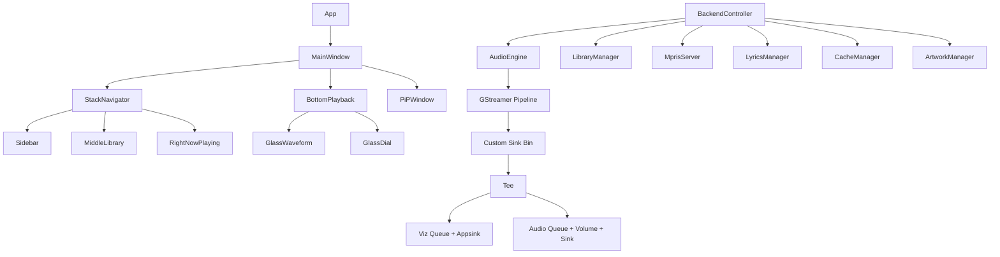

# Documentation Execution Plan

> **Duration**: Ongoing (parallel with development)  
> **Goal**: Complete developer + user documentation  
> **Branch**: `docs`

---

## 🎯 Documentation Targets

| Audience | Format | Location |
|----------|--------|----------|
| **Developers** | Markdown + Doxygen | `docs/dev/`, inline |
| **Users** | Markdown + Man pages | `docs/user/`, `man/` |
| **Contributors** | Markdown | `CONTRIBUTING.md`, `ARCHITECTURE.md` |
| **Packagers** | Markdown | `PACKAGING.md` |

---

## 📋 Documentation Structure

```
docs/
├── dev/
│   ├── architecture.md          # System architecture
│   ├── getting_started.md       # Build & run
│   ├── coding_standards.md      # C++ style, GTK patterns
│   ├── component_guide.md       # Custom widgets
│   ├── shader_guide.md          # GLSL shaders
│   ├── testing_guide.md         # Unit/integration/E2E
│   ├── debugging.md             # GDB, ASan, GTK Inspector
│   └── api/
│       ├── audio_engine.md
│       ├── storage.md
│       ├── mpris.md
│       └── lyrics.md
├── user/
│   ├── installation.md          # AppImage, Flatpak, source
│   ├── quick_start.md           # First run
│   ├── library_management.md    # Scan, organize
│   ├── playback_controls.md     # Keyboard, media keys, MPRIS
│   ├── artwork_management.md    # Fetch, edit, cache
│   ├── lyrics.md                # Embedded, LRC, external
│   ├── pip_mode.md              # Picture-in-Picture
│   ├── keyboard_shortcuts.md    # Complete reference
│   ├── troubleshooting.md       # Common issues
│   └── faq.md
├── contributing.md
├── architecture.md
├── packaging.md
└── changelog.md
```

---

## 📋 Task Breakdown

### Phase 1: Developer Docs (Week 1)

| Task | File | Priority |
|------|------|----------|
| Architecture overview | `docs/dev/architecture.md` | 🔴 Critical |
| Build instructions | `docs/dev/getting_started.md` | 🔴 Critical |
| Coding standards | `docs/dev/coding_standards.md` | 🟠 High |
| CMake guide | `docs/dev/cmake_guide.md` | 🟠 High |
| GTK patterns | `docs/dev/gtk_patterns.md` | 🟠 High |
| Shader development | `docs/dev/shader_guide.md` | 🟠 High |
| Testing guide | `docs/dev/testing_guide.md` | 🟠 High |
| Debugging | `docs/dev/debugging.md` | 🟡 Medium |

---

### Phase 2: API Reference (Week 2)

**Tool**: Doxygen + m.css theme

**File**: `Doxyfile`

```ini
PROJECT_NAME           = "Lollypop C++"
PROJECT_NUMBER         = 1.0.0
OUTPUT_DIRECTORY       = docs/api
INPUT                  = include src
RECURSIVE              = YES
EXTRACT_ALL            = YES
EXTRACT_PRIVATE        = YES
EXTRACT_STATIC         = YES
GENERATE_HTML          = YES
HTML_OUTPUT            = html
HTML_FILE_EXTENSION    = .html
HTML_HEADER            = docs/templates/doxygen_header.html
HTML_FOOTER            = docs/templates/doxygen_footer.html
HTML_EXTRA_STYLESHEET  = docs/templates/doxygen.css
GENERATE_TREEVIEW      = YES
GENERATE_LATEX         = NO
GENERATE_MAN           = YES
MAN_OUTPUT             = man
MAN_EXTENSION          = .3
CASE_SENSE_NAMES       = YES
HIDE_UNDOC_MEMBERS     = NO
HIDE_UNDOC_CLASSES     = NO
ALPHABETICAL_INDEX     = YES
```

**Build**:
```bash
doxygen Doxyfile
# Output: docs/api/html/, docs/man/
```

**C++ Documentation Standards**:
```cpp
/**
 * @class AudioEngine
 * @brief GStreamer-based audio playback with visualization support.
 * 
 * Manages the playback pipeline including custom audio sink bin
 * with tee for visualization branch.
 * 
 * @thread_safety Thread-safe for all public methods.
 * @see AudioEngine::PlaybackState
 */
class AudioEngine {
public:
    /**
     * @brief Load and preroll a track.
     * @param file_path Absolute path to audio file.
     * @return true on success, false on failure.
     * @throws std::runtime_error if pipeline not initialized.
     */
    bool load_track(const std::string& file_path);
};
```

---

### Phase 3: User Documentation (Week 3)

| Task | File | Priority |
|------|------|----------|
| Installation | `docs/user/installation.md` | 🔴 Critical |
| Quick start | `docs/user/quick_start.md` | 🔴 Critical |
| Keyboard shortcuts | `docs/user/keyboard_shortcuts.md` | 🔴 Critical |
| Library management | `docs/user/library_management.md` | 🟠 High |
| Playback controls | `docs/user/playback_controls.md` | 🟠 High |
| PiP mode | `docs/user/pip_mode.md` | 🟠 High |
| Troubleshooting | `docs/user/troubleshooting.md` | 🟠 High |
| FAQ | `docs/user/faq.md` | 🟡 Medium |

**Screenshot Automation**:
```bash
#!/bin/bash
# scripts/capture_screenshots.sh
# Uses xvfb-run + app to capture each screen
VIEWS=("main" "albums" "artists" "now_playing" "pip" "settings")
for view in "${VIEWS[@]}"; do
    ./scripts/capture_view.sh "$view" "docs/assets/screenshots/${view}.png"
done
```

---

### Phase 4: Architecture & Contributing (Week 4)

| Task | File | Priority |
|------|------|----------|
| Architecture deep dive | `docs/dev/architecture.md` | 🔴 Critical |
| Contributing guide | `CONTRIBUTING.md` | 🔴 Critical |
| Architecture diagram | `docs/architecture.drawio` | 🟠 High |
| Packaging guide | `PACKAGING.md` | 🟠 High |
| Release process | `RELEASE_PROCESS.md` | 🟠 High |
| Security policy | `SECURITY.md` | 🟡 Medium |

**Architecture Diagram** (Mermaid):


---

## 📦 Documentation Build & Deploy

### Local Build

```bash
# Install deps
pip install sphinx sphinx-rtd-theme breathe doxygen

# Build
mkdir -p docs/build
cd docs
doxygen Doxyfile
sphinx-build -b html . build/html

# Serve locally
cd build/html && python -m http.server 8000
```

### CI Integration (GitHub Pages)

**File**: `.github/workflows/docs.yml`

```yaml
name: Deploy Docs

on:
  push:
    branches: [main]
  workflow_dispatch:

jobs:
  deploy:
    runs-on: ubuntu-latest
    steps:
      - uses: actions/checkout@v4
      - name: Install deps
        run: |
          apt-get update && apt-get install -y doxygen graphviz
          pip install sphinx sphinx-rtd-theme breathe
      - name: Build docs
        run: |
          doxygen Doxyfile
          cd docs && sphinx-build -b html . build/html
      - name: Deploy to GitHub Pages
        uses: peaceiris/actions-gh-pages@v3
        with:
          github_token: ${{ secrets.GITHUB_TOKEN }}
          publish_dir: docs/build/html
```

---

## 📝 Documentation Standards

### Markdown Style

```markdown
# Heading 1
## Heading 2
### Heading 3

**Bold**, *italic*, `code`

```cpp
// Code blocks with language
int main() { return 0; }
```

> Blockquote

- List item
- **Bold** item

| Table | Header |
|-------|--------|
| Cell  | Data   |

[Link](url)

```

### Code Documentation

```cpp
/**
 * @brief Brief description.
 * 
 * Detailed description with @param, @return, @throws.
 * 
 * @param param_name Description.
 * @return Description.
 * @throws ExceptionType Condition.
 * @see RelatedClass::method()
 */
ReturnType method_name(ParamType param_name);
```

---

## 📊 Documentation Metrics

| Metric | Target |
|--------|--------|
| API coverage | 100% public API |
| User guide completeness | 100% features |
| Screenshot coverage | 100% views |
| Code example coverage | >90% public methods |
| Translation readiness | i18n-ready strings |

---

## 📝 Maintenance

| Frequency | Task |
|-----------|------|
| Per PR | Update affected docs |
| Weekly | Link check (`lychee`) |
| Monthly | Screenshot refresh |
| Per release | Changelog + version bump |
| Quarterly | Full audit |

---

## 📝 Notes

- **Doxygen + Sphinx** = C++ API + narrative docs
- **Mermaid** for diagrams (renders in GitHub/GitLab)
- **Screenshots**: Capture at 2x for retina
- **Versioning**: Docs versioned with code (git tags)
- **Search**: Algolia DocSearch (free for open source)

---

**Next**: Start with `docs/dev/getting_started.md` and `Doxyfile` setup