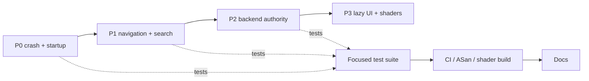

# Implementation priority & Nemotron handoff plan

Date: 2026-11-23  
Companion document: `APPLICATION_DIAGNOSIS.md`

This is my read of the ~110-item extracted backlog, stripped of duplicates and items that are already in the tree, plus an execution order you can paste into a large model.

---

## 0. Reality check: how much is actually left?

Your extraction is accurate as a list of *intentions*, but it overstates the amount of net-new work:

- Many entries are the same item repeated across plans (e.g. "SongsPage lazy model" appears in 4 documents).
- Several "0% done" items are actually structurally present in code.
- A few blockers from older plans are already partially fixed.

Verified against the current tree:

| Claimed pending | Actual state | Net work |
| --- | --- | --- |
| "Verify no mock fallbacks" | `MockLibraryService` / `MockLyricsService` exist but are **never instantiated**; `MainWindow` passes the real `BackendController` via `dynamic_cast`. | Done. Delete dead mock files only if desired. |
| "Single scroller redesign — 0% started" | `MiddleLibrary` already has `Overlay → ScrolledWindow → ContentBox → Stack`, floating glass toolbar, real Home/Albums/Artists/... pages. | ~30% left: nested scroller, history state, responsive grid, toolbar actions. |
| "HomePage non-scrolling content provider" | Present. | Done, but "View all" callbacks are broken (see P0-2). |
| "Search debounce + FTS5 + generation" | Present in code. | Broken by invalid `GWeakRef`; also runs synchronously. Needs repair, not a rewrite. |
| "RightNowPlaying controls / lyrics auto-request / queue sync" | All wired in `MainWindow::connect_backend()`. | Done; verify only. |
| "BottomPlayback volume + mode buttons" | `VolumeDial` + mode buttons exist. | Done; verify only. |
| "Shaders — 0% compiled" | 10 shader source files + `compile_gsk_shader()` CMake target exist, but `gsk-glsl-compiler` is **not installed**, so no `.gskshader` is produced; no `ShaderManager` exists. | Tooling + integration, not GLSL authoring. |
| "VisualizerEngine/CavaVisualizer not constructed" | Confirmed: `controller.cpp` only unsubscribes `spectrum_subscription_id_` in shutdown; never constructs them in `initialize()`. | Still open (R-01). |
| "IPlayerService::can_seek()" | Already exists. | R-02 is only the generation/debounce behaviour. |
| Docs / tests / CI | `docs/` has 6 files; `tests/` has 4 test files; no dev docs, no Doxygen, no CI. | Large but low-risk; defer. |

### Honest estimate

- Surface items: **~110**.
- Distinct, non-duplicate work streams after collapsing: **~35–40**.
- Actually blocking correctness/launch: **~8–10**.
- Substantial but not blocking: **~10–12**.
- Polish / docs / infrastructure: **~15–20**.

Rough solo effort:

| Bucket | Scope | Estimate |
| --- | --- | --- |
| P0 — crash + startup + CSS path | 5 items | 3–5 working days |
| P1 — navigation state + search + backend authority | 6 items | 1–2 weeks |
| P2 — lazy UI, artwork, visual system, shaders | 8–10 items | 3–6 weeks |
| P3 — tests, CI, docs, optimized data structures | 15+ items | 2–4 weeks (or never, if not needed) |

**Total realistic completion: 8–16 focused weeks for one engineer.** A strong model can compress implementation, but verification, build fixing, and manual UI checks will dominate. Do **not** expect one prompt to finish this safely.

### My recommendation on model choice

- **Nemotron 550b / max-thinking:** use for Phase 0 and Phase 1 — these need cross-file architectural judgement (navigation history model, backend lifecycle, D-Bus/UI threading).
- **Nemotron 120b / max-thinking:** fine for tightly scoped tasks with explicit file lists — CSS path fix, Home callback fix, shader CMake scaffolding, focused tests, docs.
- Give **one phase per session**. Require build + test + diff summary after each. Never paste the whole 110-item list at once; it will produce shallow, contradictory changes.

---

## 1. Priority rules

1. **Crash / data correctness first.** A beautiful UI is irrelevant if typing in search segfaults.
2. **Time-to-interactive next.** Present a window before doing slow backend work.
3. **Navigation state correctness.** History, back/forward, detail params, scroll offsets, sidebar highlight.
4. **Backend authority & pipelines.** Visualizer, seek, source ownership — only after UI is stable enough to observe them.
5. **Performance structures (lazy models, caches).** Only where profiling shows a need; most of the "optimized" plan is premature until steps 1–4 are done.
6. **Visual system / shaders / docs / CI last.**

Explicitly defer: `ScanDAG`, `LazyTrackIndex`, Fenwick/skip-list/Bloom-filter structures, co-play graph, Dijkstra playlist transitions, and the Doxygen/m.css site. They are design documents, not blockers.

---

## 2. Consolidated priority list

### P0 — Must fix before anything else

| ID | Task | Files | Done when |
| --- | --- | --- | --- |
| P0-1 | Replace invalid `GWeakRef` usage on C++ objects with safe lifetime tokens | `frontend/include/panels/middle_library.hpp`, `frontend/src/panels/middle_library.cpp`, `frontend/src/ui/pages/SearchResultsPage.cpp` | Typing/deleting search text and lazy-loading results never crash; ASan clean. |
| P0-2 | Fix Home "View all" callbacks | `frontend/src/ui/components/HomePage.cpp`, `include/ui/components/HomePage.hpp` | All three buttons navigate to Songs/Favourites. |
| P0-3 | Load CSS from absolute/gresource path and report errors | `frontend/src/application.cpp`, `frontend/src/ui/theme/ThemeManager.cpp`, `resources/lollypop.gresource.xml` | App is styled when launched from `/tmp`. |
| P0-4 | Present window before slow backend init; defer MPRIS/audio/cache/queue to idle | `frontend/src/application.cpp`, `backend/src/controller.cpp` | Window appears in <1 s; backend completes shortly after without blocking input. |
| P0-5 | Stop full unconditionally rescan on every launch | `backend/src/controller.cpp`, `backend/src/library_scanner.cpp`, `frontend/src/main_window.cpp` | Scan is delayed, incremental (mtime+size), and refreshes UI at most once. |

### P1 — Correctness and core wiring

| ID | Task | Files | Done when |
| --- | --- | --- | --- |
| P1-1 | Structured navigation history `{page_id, params, scroll}`; restore detail IDs/filters; parent mapping for sidebar highlight | `frontend/src/panels/middle_library.cpp/.hpp`, `left_sidebar.cpp`, `main_window.cpp` | Back/forward restores exact view; sidebar always highlights a valid item. |
| P1-2 | Remove nested `ScrolledWindow` from `SearchResultsPage`; use shared adjustment for lazy load | `frontend/src/ui/pages/SearchResultsPage.cpp/.hpp`, `middle_library.cpp` | One vertical scrollbar; search lazy-loads via shared scroller. |
| P1-3 | Worker-thread FTS + generation/cancellation; fix `SongsPage` stale loads and filter sync | `SearchResultsPage.cpp`, `SongsPage.cpp`, `backend/src/controller.cpp` | Rapid typing/sorting yields only newest results; UI stays responsive. |
| P1-4 | R-01: construct `VisualizerEngine` + `CavaVisualizer`, wire appsink sample → EventBus → GTK main context | `backend/src/controller.cpp`, `visualizer_engine.cpp`, `cava_visualizer.cpp`, `event_bus.cpp` | Spectrum events reach UI with lifetime-safe marshalling; no use-after-free on shutdown. |
| P1-5 | R-02: seek generation token + debounced commit (150–250 ms) + `ASYNC_DONE` confirmation | `controller.cpp`, `audio_engine.cpp`, `IPlayerService.hpp`, `ProgressWave.cpp` | Dragging progress never fights playback; unseekable sources show progress-only. |
| P1-6 | R-03: explicit source model (`Internal` / `ExternalMpris` / `ShellOnly`) routed through `PlaybackSourceManager` | `controller.cpp`, `playback_source_manager.cpp`, `IPlayerService.hpp`, `docs/AUTHORITY_MODEL.md` | Transport verbs follow one authority path; unsupported next/prev disabled, not fake-success. |

### P2 — Performance and UI system

| ID | Task | Done when |
| --- | --- | --- |
| P2-1 | Lazy-create pages on first navigation; cache page data instead of full rebuild | Only Home + active page exist at startup; scan refresh preserves filters/selection. |
| P2-2 | Verify/complete async artwork decode + LRU `ArtworkCache` (100 textures) + gradient fallback | No synchronous pixbuf decode in row creation; cache bounded. |
| P2-3 | Responsive album grid (2→6 cols), square artwork, detail hero headers, search grouping | Visual check at 800×600 and 1440×900 passes. |
| P2-4 | Install `gsk-glsl-compiler`, build shaders target, load via `ShaderManager` | `.gskshader` files produced and loaded; no missing-resource warnings. |
| P2-5 | Custom widgets: `GlassPanel`, `ArtworkCard`, `GlassDial`, `GlassWaveform`, `GlassToolbar`, `GlassPopover`, `StackNavigator` | Replaces ad-hoc boxes where appropriate; no double parenting. |
| P2-6 | Typography (Inter scale, dynamic type), reduced-motion, ATK roles, keyboard nav | Accessibility checks pass. |

### P3 — Infrastructure (defer until P0/P1 green)

- Focused tests: ~30 meaningful unit/integration tests, not 100+ nominal ones. Seed with: search crash regression, Home navigation, history restore, seek debounce, source authority, scan incremental, CSS path.
- CI: build + `ctest` + ASan job + shader build job.
- Docs: `docs/dev/architecture.md`, `getting_started.md`, `gtk_patterns.md`, `testing_guide.md`, `troubleshooting.md`; then Doxygen if wanted.
- Optimized data structures: only if profiling says storage/scan/search are still hot after P1.

---

## 3. Phase-by-phase implementation plan

### Phase 0 — Stop the bleeding (P0-1 … P0-5)

**Goal:** app launches, search does not crash, navigation basics work, style is reliable.

**Order:**

1. P0-1 `GWeakRef` fix. Use `std::shared_ptr<bool>` lifetime token owned by page, or weak-ref the actual GObject widget with owner data. Cancel pending sources in destructors. Unref every `g_weak_ref_get()` result.
2. P0-2 Home callbacks: set `recently_added_cb_`, `recently_played_cb_`, `favourite_albums_cb_` in setters; make button handler call the stored `SectionData::view_all_cb` by reference.
3. P0-3 CSS: add a compile definition `LOLLYPOP_DATA_DIR` pointing at installed resources, or put `style.css` in `lollypop.gresource.xml` and load `resource:///com/mahesh/lollypop/style.css`. Check `GError` and log.
4. P0-4 Startup: in `on_activate()`, create/present `MainWindow` first with a loading state; move `backend_->initialize()` to `g_idle_add_full(G_PRIORITY_LOW, ...)`. Within backend init, defer MPRIS/lyrics/cache/queue; make audio lazy until first play.
5. P0-5 Scan: delay scan with an idle source; compare mtime+size before TagLib parsing; throttle progress to ~100 ms; make `library_changed` trigger one coalesced UI refresh.

**Exit criteria / commands:**

```sh
cmake --build build -j$(nproc)
ctest --test-dir build --output-on-failure
cmake --build build-asan -j$(nproc)
(cd /tmp && /home/mahesh/Projects/lollypop-cpp/build/lollypop-cpp)  # styled, no crash when typing in search
```

---

### Phase 1 — Navigation and search correctness (P1-1 … P1-3)

**Goal:** back/forward/detail/search behave like a real navigator.

**Order:**

1. Define `struct NavEntry { std::string page_id; std::string param; double scroll; }` in `middle_library.hpp`. Replace `history_`/`active_page_id_` logic. `open_album_detail(id)` and `open_artist_detail(id)` push entries with `param=id`; `show_genre(genre)` pushes `param=genre`; back/forward call the page setters before showing the stack child.
2. Add a `sidebar_page_for(page_id)` mapping: `album_detail → albums`, `artist_detail → artists`, `search → songs` (or a dedicated search item). Only call `set_active_item_visual()` with a real nav ID.
3. Reset/restore the shared scroll adjustment on every `navigate_to_page()` and on back/forward.
4. Remove both `gtk_scrolled_window_new()` calls from `SearchResultsPage`; return a `Box + ListBox` like `SongsPage`. Connect lazy load to `MiddleLibrary`'s shared adjustment.
5. Move `search_tracks()` to a worker (`std::async` or GTask) with a monotonically increasing generation; marshal back with `g_idle_add`; check generation before appending. Apply the same generation check in `SongsPage::append_tracks()` and reset `loading_` before a new load.

**Exit criteria:** manual script: open album → back → forward → same album + scroll; type/delete search 10× fast; sort Songs 5× fast; no stale rows, no crash, one scrollbar.

---

### Phase 2 — Backend authority and pipelines (P1-4 … P1-6)

**Goal:** visualizer, seek, and source authority are real, not decorative.

**Order:**

1. R-01: construct `VisualizerEngine` and `CavaVisualizer` in `BackendController::initialize()`; connect appsink `new-sample` with a `shared_ptr<bool>` lifetime token; push spectrum through `EventBus`; deliver to GTK with `g_main_context_invoke()`. Unsubscribe before tearing down audio.
2. R-02: add `seek_generation_` to `IPlayerService`/controller; debounce `seek()` calls 150–250 ms; commit on `ASYNC_DONE`; `can_seek()` drives `ProgressWave::set_can_seek()`.
3. R-03: implement `PlaybackSource` enum + capability flags; route play/pause/next/prev/seek/volume through `PlaybackSourceManager`; disable unsupported controls instead of silently doing nothing. Update `docs/AUTHORITY_MODEL.md` to match code.

**Exit criteria:** visualization responds to playback; scrubbing does not stutter; external MPRIS next/prev works or control is insensitive; ASan shutdown clean.

---

### Phase 3 — Performance and visual system (P2-1 … P2-6)

Only start after Phases 0–2 are green.

1. Lazy page creation + per-page data cache (`std::unordered_map<std::string, std::unique_ptr<LibraryPage>>` created on demand).
2. Artwork: confirm `GdkTexture` decode happens off-thread; verify LRU size 100; add gradient fallback for missing art.
3. Responsive grid / detail hero / search grouping with CSS classes from the redesign plan.
4. Install `gsk-glsl-compiler` (or document it as a required dep), build `shaders` target, add `ShaderManager`, load `.gskshader` from resources. Wire one shader first (`glass`), then the rest.
5. Custom widgets and accessibility last; replace ad-hoc boxes incrementally, never in one big rewrite.

---

### Phase 4 — Tests, CI, docs (P3)

Add tests **alongside** each phase rather than in one final burst. Minimum useful set:

- `test_navigation.cpp` — history push/pop, param restore, sidebar mapping.
- `test_search_Lifetime.cpp` — repeated search + destroy page, no crash.
- `test_seek.cpp` — generation/debounce.
- `test_scan_incremental.cpp` — unchanged files skipped.
- `test_css_path.cpp` — resource loads from arbitrary CWD.
- `test_authority.cpp` — source routing matrix.

Then add GitHub Actions: build, `ctest`, ASan, shader build. Docs after the code stops moving.

---

## 4. Dependency graph



---

## 5. Ready-to-paste prompt for Nemotron (use one phase at a time)

> You are working in `/home/mahesh/Projects/lollypop-cpp`, a C++20 / GTK4 / libadwaita music player.
>
> **Context to read first:** `AGENTS.md`, `APPLICATION_DIAGNOSIS.md`, `IMPLEMENTATION_PRIORITY_AND_HANDOFF.md`.
>
> **Your assignment for this session: Phase 0 only (P0-1 … P0-5).** Do not implement Phase 1+, do not rewrite the whole app, do not touch the many `.md` planning files except to read them.
>
> **Hard constraints:**
> 1. Preserve all uncommitted user work; do not revert or delete files such as `critique.md`, `MIDDLE_PANEL_REDESIGN.md`, `resources/style.css.backup`, `build-asan/`.
> 2. Never call `g_weak_ref_init/get/clear` on a non-GObject C++ object. Use a shared lifetime token or weak-ref the actual GObject widget.
> 3. No relative paths for resources. Load CSS from a compiled-in absolute path or gresource, and check the `GError`.
> 4. No slow backend work (GStreamer, D-Bus, SQLite migrations, full scan) before the first window frame; defer to idle/worker.
> 5. No nested `GtkScrolledWindow` in the middle panel.
> 6. Use the real `BackendController` services; do not introduce mock fallbacks.
>
> **Tasks:** implement P0-1, P0-2, P0-3, P0-4, P0-5 as described in section 3 of the handoff document. For each task: make the minimal code change, add or update one focused test if practical, then run:
>
> ```sh
> cmake --build build -j$(nproc)
> ctest --test-dir build --output-on-failure
> cmake --build build-asan -j$(nproc)
> ```
>
> **Manual verification:** launch from `/tmp`, confirm stylesheet applies, type a search query, confirm no crash, confirm window appears before scanning starts.
>
> **Report format:** (1) list of changed files with one-line rationale each, (2) build/test output summary, (3) any behaviour you could not verify, (4) exact next-phase task IDs you recommend. If you are blocked or unsure about an API, stop and ask instead of guessing.

**For Phase 1+ sessions**, replace the assignment line with `Phase 1 only (P1-1 … P1-3)` etc., and add: "Do not begin Phase 2 until Phase 1 exit criteria are demonstrated."

---

## 6. Final opinion

The backlog is large on paper but **front-loaded**: roughly 8–10 items decide whether the app is usable at all. Fix those first and the remaining ~30 items become ordinary feature work rather than firefighting.

If you hand one model the full 110-item list, you will get a mixture of already-done code, speculative rewrites, and new regressions. Hand it **Phase 0** first, require the build/ASan/manual checks, then promote to Phase 1. Use 550b for the architecture phases, 120b for bounded mechanical work, and keep the human in the loop at each gate.
